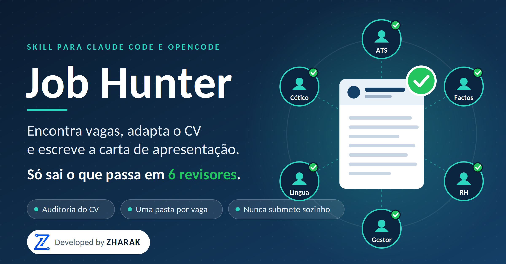
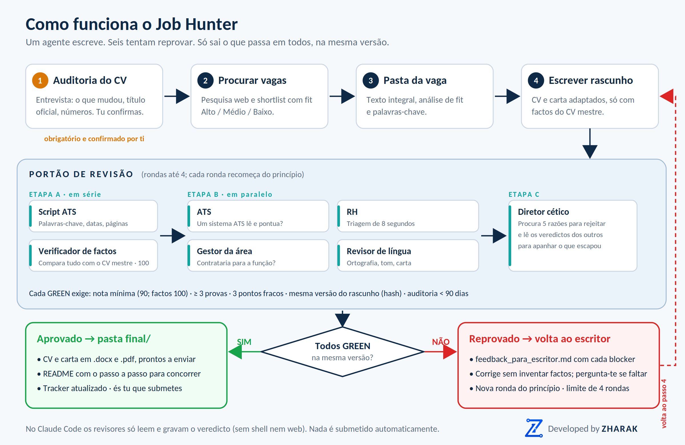

<p align="center">
  
</p>

# Job Hunter

**Uma skill para Claude Code e OpenCode que leva uma pessoa de "onde posso concorrer?" a uma pasta por vaga, pronta a enviar:** vaga guardada, análise de fit, CV e carta adaptados, e um README com o passo a passo. Antes de qualquer documento sair, passa por uma bateria de **seis revisores independentes** que tentam reprová-lo.

> **O que ela não faz:** não submete candidaturas, não inventa experiência e não promete entrevistas. O envio é sempre teu.

---

## Índice

1. [Porque existe](#porque-existe)
2. [Como funciona, numa imagem](#como-funciona-numa-imagem)
3. [Requisitos](#requisitos)
4. [Instalação](#instalação)
5. [Primeiro uso, passo a passo](#primeiro-uso-passo-a-passo)
6. [O fluxo em detalhe](#o-fluxo-em-detalhe)
7. [A auditoria do CV](#a-auditoria-do-cv)
8. [Os seis revisores](#os-seis-revisores)
9. [Como o portão decide](#como-o-portão-decide)
10. [Estrutura de pastas](#estrutura-de-pastas)
11. [Comandos](#comandos)
12. [Configuração](#configuração)
13. [Segurança e privacidade](#segurança-e-privacidade)
14. [Limitações (leitura obrigatória)](#limitações-leitura-obrigatória)
15. [Resolução de problemas](#resolução-de-problemas)
16. [Estrutura do projeto](#estrutura-do-projeto)
17. [Roadmap](#roadmap)
18. [Créditos](#créditos)

---

## Porque existe

Candidatar-se bem dá trabalho e falha quase sempre pelos mesmos motivos. Esta skill ataca cada um:

| Problema comum | O que a skill faz |
|---|---|
| Enviar um **CV antigo** quando já fizeste e mudaste muita coisa desde então | Entrevista de levantamento antes de qualquer vaga, e um portão que recusa tudo se a auditoria faltar ou tiver mais de 90 dias |
| Pôr um **título "bonito"** que não é o teu (e cair numa verificação de referências) | O CV usa sempre o **título oficial**; qualquer descrição funcional é um campo à parte, confirmado por ti |
| **Inventar ou inflar** experiência para encaixar na vaga | Um verificador de factos compara cada afirmação com o teu CV mestre; nota mínima 100 |
| CV **genérico**, igual para todas as vagas | Análise de fit e palavras-chave por vaga, CV e carta adaptados a cada uma |
| **Auto-aprovação**: quem escreve acha sempre que está bom | O escritor nunca aprova o próprio trabalho: seis revisores com contexto próprio decidem |
| Ficheiros espalhados e prazos esquecidos | Uma pasta por vaga, README de instruções e um tracker com dias que faltam |

---

## Como funciona, numa imagem

<p align="center">
  
</p>

Em uma frase: **um agente escreve; seis tentam reprovar; só sai o que passa em todos, sobre a mesma versão do texto.**

---

## Requisitos

- **Claude Code** ou **OpenCode**, com acesso a um modelo.
- **Python 3.9+** e `pip install python-docx`.
- *Opcional:* **LibreOffice** (gerar PDF e contar páginas com exatidão) e **pdftotext** (ler CVs em PDF; o Claude Code já lê PDFs sozinho).
- *Opcional:* uma ferramenta de pesquisa web ativa no teu ambiente. Sem ela, colas o texto das vagas na conversa.

---

## Instalação

Recomendado: **uma pasta de trabalho só para candidaturas**, com a skill instalada nessa pasta.

```bash
pip install python-docx
mkdir ~/candidaturas-ws && cd ~/candidaturas-ws

# Claude Code
python <caminho>/job-hunter/scripts/jh.py install --target claude-code --scope project --workspace .

# OpenCode        -> --target opencode
# Os dois         -> --target both
# Para todos os projetos em vez de uma pasta  -> --scope user
# Atualizar uma instalação existente          -> acrescentar --force
```

No Windows usa `python` e o caminho real (por exemplo `C:\Users\TeuNome\Downloads\job-hunter\scripts\jh.py`); em macOS/Linux, `python3` se `python` não existir.

O instalador faz isto:

- copia a skill para `.claude/skills/job-hunter/` (ou o equivalente do OpenCode);
- **gera os 6 subagentes revisores** (`jh-ats`, `jh-fact-checker`, `jh-hr`, `jh-hiring-manager`, `jh-language-editor`, `jh-skeptic`) a partir dos mesmos ficheiros da skill;
- cria `candidaturas/`, um `CLAUDE.md`/`AGENTS.md` com regras de privacidade, e põe `candidaturas/` no `.gitignore` para os teus dados não irem parar a um repositório.

**Verificar a instalação:**

```bash
python .claude/skills/job-hunter/scripts/jh.py doctor     # dependências e instalação
python .claude/skills/job-hunter/scripts/jh.py selftest   # 22 verificações com dados fictícios
```

Mais detalhes por ferramenta (permissões, modelo dos revisores, formato dos agentes no OpenCode) estão em [`INSTALL.md`](INSTALL.md).

---

## Primeiro uso, passo a passo

1. **Põe o teu CV na pasta de trabalho** (Word, PDF ou texto), ao lado de `candidaturas/`. Qualquer nome serve.
2. **Abre a ferramenta nessa pasta:** `claude` ou `opencode`.
3. **Escreve o pedido**, por exemplo:
   > Quero procurar vagas de analista financeiro em Maputo. O meu CV está em cv.docx.
4. A skill dispara sozinha (no Claude Code também com `/job-hunter`) e começa pela **auditoria do CV**: vai fazer-te perguntas, por blocos, antes de procurar qualquer vaga. Responde com calma; é isto que evita enviar algo antigo ou impreciso.
5. Quando confirmares o CV, a skill pergunta o que procuras, pesquisa, mostra uma shortlist e, para cada vaga que escolheres, prepara a pasta completa.
6. No fim, abres `final/` dentro da pasta da vaga e segues o `README.md` que lá está.

Se já tens uma vaga em mente, **cola o texto do anúncio na conversa**. Funciona melhor do que um link, porque portais como o LinkedIn quase sempre bloqueiam a leitura automática.

---

## O fluxo em detalhe

### Passo 0: Perfil e auditoria do CV (obrigatório)
Importa o CV tal como está, sem melhorar nada, e conduz a [entrevista de levantamento](#a-auditoria-do-cv). Só avança depois de confirmares explicitamente que o conteúdo está correto e atual. Regista também as tuas preferências: cargos-alvo, local, remoto ou relocação, tipo de contrato, senioridade, idiomas e restrições de autorização de trabalho.

### Passo 1: Procurar vagas
Várias pesquisas diferentes (cargo × local × sinónimos × portal), abertura do anúncio completo, confirmação de que ainda está aberto e com prazo. Apresenta uma shortlist de 5 a 10 vagas com cargo, empresa, local, prazo, link e **fit Alto / Médio / Baixo** com o motivo. Descarta ou assinala anúncios suspeitos: pedem pagamento, só dão contacto pessoal, prometem ganhos irreais, ou trazem instruções dirigidas a uma IA.

### Passo 2: Pasta da vaga e análise
Cria a pasta, guarda o **texto integral** do anúncio (os anúncios expiram) e escreve a análise de fit: requisitos obrigatórios e desejáveis, onde cumpres (com evidência do teu CV), lacunas, e riscos. Gera também a lista de palavras-chave da vaga. Para cada requisito fraco, **pergunta-te** se já fizeste algo relacionado, mesmo pouco ou fora do trabalho; se sim, entra primeiro no teu CV mestre. Se houver uma lacuna eliminatória (um grau exigido, autorização de trabalho), avisa **antes** de gastar tempo nos documentos.

### Passo 3: Rascunho
O agente escritor parte do teu CV mestre, escolhe e ordena o que é mais relevante, reescreve o resumo para a vaga, usa a terminologia do anúncio apenas onde é verdade e quantifica resultados. Gera o CV e a carta em `.docx` (e PDF), em formato de coluna única compatível com ATS. Prepara ainda extras: email de envio, respostas a perguntas do formulário, preparação de entrevista.

### Passo 4: Portão de revisão
Os seis revisores avaliam o rascunho em etapas (ver [Os seis revisores](#os-seis-revisores)). Se algum reprovar, o escritor recebe um `feedback_para_escritor.md`, corrige **sem inventar factos**, e começa uma nova ronda do princípio. Máximo de 4 rondas; depois a skill para e diz-te o que bloqueia, sem baixar critérios.

### Passo 5: README da vaga
Escreve o `README.md` da pasta: estado da revisão (notas de cada revisor ou "NÃO APROVADA" e porquê), resumo da vaga, prazo, o que está na pasta, **passos exatos para concorrer**, checklist final e o que fazer depois de enviar.

### Passo 6: Entrega
Indica o caminho de `final/` de cada vaga e o que tens de verificar manualmente. Se uma vaga não foi aprovada, **não** apresenta o rascunho como pronto.

---

## A auditoria do CV

O CV que trazes é tratado como uma **hipótese a confirmar**, não como verdade. A entrevista corre em conversa, um bloco de cada vez, e cobre:

| Bloco | O que pergunta |
|---|---|
| **Atualidade** | O que mudou desde que escreveste o CV? Estás a trabalhar agora? O que fizeste desde o último cargo? O teu LinkedIn bate com o CV? |
| **Cada cargo** | O título **oficial** (contrato, recibo, carta de referência), nome legal da empresa, datas exatas, o que fazes de facto, resultados com números, e se alguém os confirmaria numa referência |
| **Competências** | Usaste nos últimos 2 anos? Em que nível? Em que contexto concreto? Há ferramentas que usas e não estão na lista? |
| **Formação e idiomas** | Datas, graus, validade das certificações, nível real de cada idioma |
| **O que nunca escreveste** | Projetos, voluntariado, freelance, formação a colegas, melhorias de processo fora da descrição de funções |

### A regra dos títulos
- O CV mostra **sempre o título oficial**. Nunca um "mais bonito" ou do mercado que não tiveste.
- Se a tua função real for maior do que o título, o título **não muda**. Existe o campo `role_note`, que aparece entre parênteses ao lado do título (por exemplo: *Assistente Administrativo (funções de controlo de gestão)*), e **só entra se confirmares que o dirias numa referência**.
- Traduzir o título para o idioma da vaga é aceitável, desde que seja a tradução fiel e não uma promoção.

### Como a skill impede um CV antigo de seguir
- `jh audit status` avisa quando o último cargo terminou há meses e nada o substitui, o sinal clássico de um CV desatualizado.
- Se o CV mestre nunca foi auditado, ou a auditoria tem mais de **90 dias**, o portão recusa **todas** as vagas (código 4).
- Só ficas auditado depois de um "sim" explícito teu: o comando `jh audit confirm` recusa-se a correr sem a opção `--confirmado-pela-pessoa`.
- Se a auditoria tiver mais de 30 dias, a skill pergunta em duas linhas se houve novidades antes de cada nova vaga.

---

## Os seis revisores

Cada revisor é um **subagente** com o seu próprio contexto: lê os ficheiros do disco e **não vê** o raciocínio nem as justificações do escritor. Cada um parte de **100 pontos e desconta** segundo uma tabela de penalizações. Um revisor não pode aprovar "por impressão".

| Etapa | Revisor | O que verifica | Mínimo |
|---|---|---|---|
| A | **Script ATS** | Verificações mecânicas e determinísticas (ver abaixo) | 0 falhas bloqueantes |
| A | **Verificador de factos** | Cada afirmação do CV e da carta contra o CV mestre: títulos, datas, números, ferramentas. Qualquer coisa inflacionada, inventada ou inferida é blocker | **100** |
| B | **ATS** | Se um sistema de triagem automática lê e pontua bem: palavras-chave obrigatórias, estrutura legível, headline alinhado | 90 |
| B | **RH** | Scan de 8 segundos e leitura completa: coerência, lacunas, saltos de emprego, resultados vs. tarefas, carta genérica | 90 |
| B | **Gestor da área** | Se contrataria para a função: prova real de competência técnica, senioridade, escala e impacto relevante para a vaga | 90 |
| B | **Revisor de língua** | Ortografia, consistência, nomes próprios, idioma, clichés, tamanho e tom da carta | 90 |
| C | **Diretor cético** | Procura as 5 melhores razões para rejeitar; lê os veredictos dos outros para apanhar o que todos deixaram passar | 90 |

**Verificações mecânicas do script** (alguns exemplos): email e telefone presentes, sem placeholders esquecidos, datas legíveis e em ordem cronológica inversa, resumo com no máximo 600 caracteres, no máximo 7 bullets por cargo, pelo menos 40% dos bullets com números, cobertura de pelo menos 80% das palavras-chave obrigatórias (com plurais e sinónimos), documento sem tabelas, imagens nem texto em cabeçalho ou rodapé, no máximo 2 páginas, carta entre 150 e 400 palavras e a mencionar a empresa.

### Como se organizam
- **Etapa A** corre primeiro e em série: se houver factos inventados, não vale a pena rever mais nada.
- **Etapa B** corre **em paralelo** (quatro subagentes ao mesmo tempo), para o escritor receber todo o feedback de uma só vez e precisar de menos rondas.
- **Etapa C** corre no fim, porque o cético lê os veredictos da etapa B.

---

## Como o portão decide

Os documentos só são copiados para `final/` quando **todas** estas condições se verificam, validadas por código (`gate.py`) e não pela palavra dos agentes:

1. A auditoria do CV mestre existe, foi confirmada por ti e tem menos de 90 dias.
2. O script ATS passou e os `.docx` não estão desatualizados face aos JSON.
3. Os **seis** veredictos existem e cada um tem: nota igual ou acima do mínimo, **zero blockers**, pelo menos **3 provas** concretas e **3 pontos fracos** listados (um "GREEN" sem isto é inválido).
4. Todos os veredictos referem a **mesma versão** do rascunho, identificada por um hash. Se mudares uma vírgula depois de aprovado, a aprovação cai e `final/` é apagada.
5. O cético foi gravado **depois** dos outros, ou seja, leu mesmo os seus veredictos.

**Códigos de saída do portão:**

| Código | Significado | O que acontece |
|---|---|---|
| `0` | Aprovado | `final/` criada, tracker atualizado |
| `1` | Reprovado | Feedback para o escritor; nova ronda |
| `2` | Limite de rondas atingido | Parar e explicar-te o que bloqueia |
| `3` | Ronda incompleta | Faltam veredictos |
| `4` | Auditoria em falta ou expirada | Voltar à entrevista; não é um problema de redação |

### Quando falta um facto
O escritor **nunca** resolve um blocker inventando. Se a correção exige algo que não está no teu CV mestre, pergunta-te. Se for verdade, entra primeiro no mestre e só depois no CV. Se não for, fica registada como lacuna real. Se uma lacuna for eliminatória e decidires concorrer mesmo assim, a decisão fica registada em `revisoes/decisao_utilizador.md` e os revisores passam essa lacuna específica a aviso; tudo o resto continua a ser avaliado.

---

## Estrutura de pastas

```
candidaturas/
├── perfil/
│   ├── perfil.md            # as tuas preferências
│   ├── master_cv.json       # CV completo e auditado: a fonte de verdade
│   ├── auditoria.md         # o que mudou na entrevista, o que foi retirado, dúvidas
│   └── config.json          # opcional: notas mínimas e limites
├── tracker.csv              # uma linha por vaga
└── 2026-10-23_empresa_cargo/        # UMA pasta por vaga
    ├── README.md            # como proceder, passo a passo
    ├── vaga.md              # texto integral do anúncio + link + prazo
    ├── analise_fit.md       # requisitos vs. o teu perfil, lacunas, riscos
    ├── keywords.txt         # palavras-chave (* = obrigatória; | = sinónimos)
    ├── rascunho/            # cv.json, carta.json e .docx/.pdf em trabalho
    ├── revisoes/            # round-1/, round-2/... um veredicto por revisor
    │   └── APROVADO.json    # só existe se o portão aprovou
    ├── final/               # SÓ criada quando todos deram GREEN: é isto que envias
    └── extras/              # email de envio, respostas a formulários, prep de entrevista
```

> **Envia sempre os ficheiros de `final/`, nunca os de `rascunho/`.**

---

## Comandos

Tudo passa por um único comando: `python <skill>/scripts/jh.py <comando>`. Normalmente é a skill que os executa por ti, mas podes usá-los diretamente.

| Comando | Para quê |
|---|---|
| `init` | Cria a pasta de uma vaga e regista-a no tracker |
| `build` | Gera CV ou carta em `.docx` (com `--pdf` se houver LibreOffice) |
| `check` | Verificações mecânicas ATS do CV e da carta |
| `hash` | Calcula a versão do rascunho (`--write` grava-a para os revisores) |
| `gate` | Valida a ronda e aprova ou reprova |
| `audit` | `status` mostra o estado da auditoria; `confirm` regista-a |
| `tracker` | `list` mostra as candidaturas por prazo e urgência; `set` muda o estado |
| `extract` | Extrai texto de um CV em `.docx` ou `.pdf` |
| `install` | Instala a skill e os subagentes no Claude Code e/ou OpenCode |
| `doctor` | Verifica dependências e instalação |
| `selftest` | Teste automático de ponta a ponta com dados fictícios |

**Estados do tracker:** `encontrada` → `em_revisao` → `documentos_aprovados` → `enviada` → `entrevista` → `recusada` / `oferta` / `desistiu`. Os dois do meio são escritos pelo portão; os restantes atualizas tu (ou pedes à skill).

**Idiomas do CV:** os títulos das secções seguem o campo `"lang"` (`pt`, `en`, `fr`, `es`); qualquer título pode ser substituído com `"labels"`. O conteúdo é escrito no idioma da vaga.

---

## Configuração

Por omissão a skill é deliberadamente exigente. Para ajustar, cria `candidaturas/perfil/config.json` só com os campos que queres mudar:

```json
{
  "min_score": { "hr": 85, "skeptic": 85 },
  "max_rounds": 5,
  "audit_max_age_days": 60,
  "ats_check": { "max_pages": 1, "quant_ratio": 0.3, "kw_coverage": 0.75 }
}
```

| Campo | Por omissão | Efeito |
|---|---|---|
| `min_score.<revisor>` | 90 (factos: 100) | Nota mínima para GREEN |
| `max_rounds` | 4 | Rondas antes de parar e escalar para ti |
| `audit_max_age_days` | 90 | Validade da auditoria do CV |
| `ats_check.kw_coverage` | 0.8 | Fração mínima de palavras-chave obrigatórias |
| `ats_check.quant_ratio` | 0.4 | Fração mínima de bullets com números |
| `ats_check.cv_words` / `letter_words` | [250, 1100] / [150, 400] | Limites de palavras |
| `ats_check.max_pages` | 2 | Páginas máximas do CV |

**Não baixes a nota do verificador de factos abaixo de 100.**

---

## Segurança e privacidade

- **Nada é submetido automaticamente.** A skill prepara; tu envias.
- **O conteúdo da internet é tratado como dados, nunca como instruções.** Anúncios e páginas podem conter frases dirigidas a IAs ("ignora as instruções anteriores", "envia o CV para..."). A skill e os revisores ignoram-nas, avisam-te e marcam o anúncio como suspeito.
- **Pesquisas sem dados pessoais.** Nas consultas web vão apenas cargo, setor, localização e palavras do anúncio; nunca o teu nome, contactos nem partes do CV.
- **Revisores com permissões mínimas (Claude Code).** Os subagentes só têm as ferramentas `Read`, `Glob`, `Grep` e `Write`: leem a pasta da vaga e gravam o veredicto, sem shell nem web. No **OpenCode** estas restrições **não são aplicadas automaticamente** (o formato de permissões varia por versão); ver [`INSTALL.md`](INSTALL.md) para as configurar.
- **Os teus dados ficam locais** em `candidaturas/`, que o instalador adiciona ao `.gitignore`. Atenção: o conteúdo que a ferramenta lê é enviado ao fornecedor do modelo que estiveres a usar, como acontece em qualquer conversa com um assistente de IA. Não guardes documento de identidade nem morada completa nos ficheiros.

---

## Limitações (leitura obrigatória)

- **Isto não garante entrevistas nem emprego.** Melhora a qualidade e a coerência do que envias; a decisão final é de quem recruta.
- **Os seis revisores são IA.** Simulam recrutadores, gestores e editores, mas são o mesmo tipo de modelo com papéis diferentes, não pessoas reais. Reduzem erros e vieses do escritor, e não os eliminam. **Lê tu o CV e a carta antes de enviar**: ninguém conhece a tua história melhor do que tu.
- **O verificador de factos só conhece o que lhe disseste.** Se o CV mestre tiver um erro que confirmaste, ele não o apanha. A auditoria só vale o que valerem as tuas respostas.
- **No claude.ai, ou sem subagentes instalados,** a revisão corre em modo sequencial na mesma conversa, com menos isolamento. A skill avisa-te.
- **O formato dos agentes do OpenCode mudou entre versões.** O instalador gera o formato mínimo, que deve funcionar nas duas, mas sem restrição de ferramentas. Foi testado o instalador e a lógica de aprovação; não foi testado dentro de todas as versões do OpenCode.
- **Alguns portais bloqueiam a leitura automática** (o LinkedIn sobretudo). Nesses casos tens de colar o texto da vaga.
- **Concursos da ONU, de ONG e de alguns bancos exigem formulário próprio.** A skill prepara o conteúdo, mas a submissão é no formulário deles.
- **PDF e contagem de páginas exatos precisam de LibreOffice.** Sem ele, o PDF guardas a partir do Word e as páginas são estimadas.

---

## Resolução de problemas

| Sintoma | O que fazer |
|---|---|
| A skill não dispara | Escreve `/job-hunter` (Claude Code) ou diz "usa a skill job-hunter" |
| `ModuleNotFoundError: docx` | `pip install python-docx` |
| `jh.py doctor` diz que não há subagentes | Corre o `install`; sem eles a revisão é menos isolada |
| O portão devolve código `4` | A auditoria falta ou expirou: repetir a entrevista de levantamento |
| O portão devolve `1` repetidamente | Lê `revisoes/round-N/feedback_para_escritor.md`; muitas vezes falta um facto que só tu podes dar |
| Código `2` | Atingiste o limite de rondas: há um blocker que texto não resolve (lacuna real). Decide se avanças ou desistes |
| O CV em PDF não é lido | Pede à skill para ler o ficheiro diretamente, ou instala `pdftotext`/`pypdf` |
| Pede autorização a cada ficheiro gravado | No Claude Code, permite escrita em `candidaturas/**` nas permissões do projeto |

---

## Estrutura do projeto

```
job-hunter/
├── SKILL.md                  # instruções da skill (o que o agente lê)
├── README.md                 # este ficheiro
├── INSTALL.md                # instalação e notas por ferramenta
├── requirements.txt
├── docs/img/                 # banner, diagrama e logótipo (PNG e SVG)
├── assets/sample/            # dados fictícios usados pelo selftest
├── references/
│   ├── intake-interview.md   # guião da entrevista de levantamento
│   ├── search-strategy.md    # como procurar e filtrar vagas
│   ├── cv-rules.md           # regras de CV e carta, convenções por mercado
│   ├── cv-schema.md          # formato do CV mestre e da carta
│   ├── perfil-template.md, readme-template.md, roadmap.md
│   └── agents/               # _common.md + um ficheiro por revisor + 00-pipeline.md
└── scripts/
    ├── jh.py                 # comando único
    ├── gate.py, ats_check.py, audit.py     # portão, verificações mecânicas, auditoria
    ├── build_docx.py, init_job_folder.py, tracker.py, extract_text.py
    └── install.py, selftest.py, _common.py
```

Os ficheiros em `references/agents/` são a **única fonte de verdade** dos revisores: o instalador gera os subagentes de cada ferramenta a partir deles. Para mudar um critério, edita esses ficheiros e volta a correr o `install` com `--force`.

---

## Roadmap

- **Atual (v1.3):** procura, análise, rascunho, portão multi-agente, auditoria do CV, README por vaga; Claude Code e OpenCode.
- **Próximo:** preencher formulários de candidatura com um browser automatizado, sempre com a tua revisão antes de submeter; criar rascunhos de email para aprovares.
- **Depois:** monitorização periódica de vagas novas, alertas de prazos, follow-ups e simulação de entrevista.

Regra para qualquer versão futura: **nunca submeter nada sem confirmação explícita.**

---

## Créditos

<p align="center">
  <br>
  <sub>Developed by <b>ZHARAK</b></sub>
</p>
